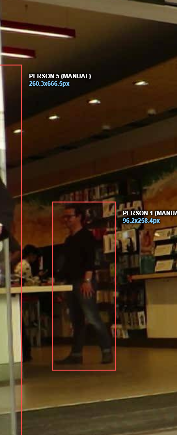
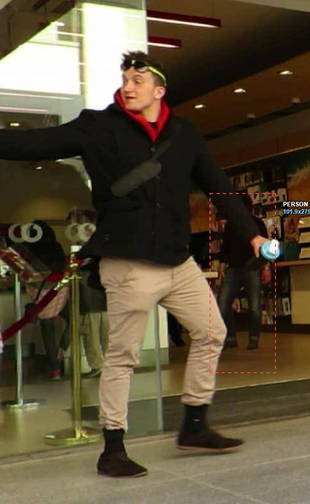
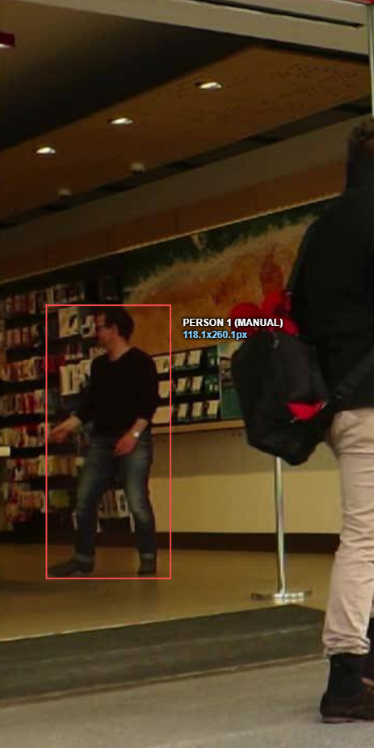

# Báo cáo cá nhân — DuongManhHuy-2A202603301

Đổi tên file theo quy tắc `MSSV_HoTen.md`. Ví dụ: `20241234_NguyenVanAn.md`.

Đoạn video: MOT17-09, 150 frame (frame 1–150), nguồn MOTChallenge, giấy phép CC BY-NC-SA 3.0.

## 0. Thông tin học viên

- Họ tên: Dương Mạnh Huy
- MSSV: 2A202603301
- Mã đề (A/B/C): C
- Email: manhhuy2104@gmail.com
- Link repository: [github.com/MHuy21/K5-L2B-DAY05-DuongManhHuy-2A202603301-MOTTracking.git](https://github.com/MHuy21/K5-L2B-DAY05-DuongManhHuy-2A202603301-MOTTracking.git)
- Giờ bắt đầu: 16h40
- Giờ kết thúc: 18h20

## 1. Xem trước đoạn video (CP0)

Ghi **trước khi vẽ**, mỗi người một dòng.

| Mã | Frame xuất hiện | Frame cuối thấy được | Rẽ / dừng / đổi tốc độ ở frame | Bị che ở frame | Ghi chú                                  |
| --- | ----------------- | ------------------------- | -------------------------------------- | ---------------- | ----------------------------------------- |
| P1  | 0                 | 149                       | 27                                     | 41               | frame 27 bắt đầu quay người để đi |
| P2  | 44                | 149                       | 71                                     | 0                |                                           |
| P3  | 0                 | 149                       | 20                                     | 0                | frame 0 chỉ thấy 1 phần cơ thể       |
| P4  | 0                 | 106                       | 3                                      | 106              | frame 3 bắt đầu bước chân           |
| P5  | 0                 | 116                       | 17                                     | 120              |                                           |

## 2. Keyframe và thời gian (CP1, CP4)

Số keyframe lấy từ kết quả `src/check_submission.py`.

| Mã             | Số keyframe | Keyframe ở frame                                                                                           | Số frame có mặt | Keyframe / 100 frame | Thời gian (phút) | Chỗ khó                                                                                                                                                                                                                                                                         |
| --------------- | ------------ | ----------------------------------------------------------------------------------------------------------- | ------------------ | -------------------- | ------------------ | --------------------------------------------------------------------------------------------------------------------------------------------------------------------------------------------------------------------------------------------------------------------------------- |
| P1              | 27           | 0, 11, 19, 21, 22, 23, 24, 25, 26, 27, 28, 29, 30, 36, 37, 49, 52, 57, 61, 68, 75, 89, 95, 98, 99, 100, 149 | 146                | 18.5                 | 34                 | Đứng trong shop sau kính. Khoảng frame 21–30 vừa quay người vừa bắt đầu bị P5 đi ngang che, phải đặt keyframe từng frame để giữ box toàn thân. Bị che một phần từ frame 26, khuất hẳn 45–48, hiện lại từ 49 và vẫn bị che một phần tới 56. |
| P2              | 11           | 45, 46, 49, 50, 61, 64, 69, 75, 89, 112, 149                                                                | 105                | 10.5                 | 14                 | Người nhỏ, mờ sau kính shop, khó xác định frame xuất hiện đầu tiên (45). Đoạn đầu bị che một phần nên keyframe dày ở 45–50.                                                                                                                              |
| P3              | 14           | 0, 5, 7, 8, 20, 28, 29, 30, 32, 34, 53, 91, 123, 149                                                        | 150                | 9.3                  | 18                 | Frame đầu chỉ thấy một phần ở mép phải; box rộng ra nhanh khi bước vào khung nên keyframe dày ở 5–8. Khoảng 28–34 [đổi hướng / đi sát người phụ nữ áo xanh lá] nên phải thêm keyframe.                                                          |
| P4              | 7            | 0, 21, 39, 85, 91, 95, 104                                                                                  | 105                | 6.7                  | 9                  | Nhỏ và xa ở cửa hàng, gần như đứng yên nên ít keyframe. Khoảng 95–104 bị cặp đôi đi ngang che rồi khuất hẳn.                                                                                                                                                |
| P5              | 20           | 0, 4, 5, 19, 36, 46, 53, 61, 67, 73, 80, 86, 104, 111, 116, 117, 129, 132, 133, 149                         | 138                | 14.5                 | 25                 | Gần camera, đi nhanh, box lớn và đổi kích thước liên tục. Frame đầu bị cắt ở mép trái. Khoảng 111–117 đi vào sau cặp đôi, chỉ lộ lại 129–133, khuất 137–148.                                                                                       |
| **Tổng** | 79           |                                                                                                             | 644                | **12.3**       | 100                |                                                                                                                                                                                                                                                                                   |

Keyframe / 100 frame của cả bài = tổng keyframe ÷ tổng số frame có mặt × 100 = 79 ÷ 644 × 100 = 12.3

Bạn đặt keyframe nhiều nhất ở người nào? Vì sao (người đó rẽ, dừng, lại gần camera hay bị che)?

P1; lý do là ở frame 19–30, P1 vừa quay người đổi hướng vừa bắt đầu bị P5 che. Tôi phải ước lượng box toàn thân gần như từng frame. Ngoài ra tôi đặt thêm keyframe ngay trước khi P1 khuất hẳn (frame 36–37) và ngay khi hiện lại (frame 49–57).

## 3. Đoạn bị che (CP2)

Người bị che: `P1`

| Mốc                                              | Frame |
| ------------------------------------------------- | ----: |
| Bắt đầu bị che một phần (bật `occluded`) |    26 |
| Mất hẳn (bật `outside`)                      |    45 |
| Hiện lại (tắt `outside`)                     |    49 |
| Thấy rõ trở lại (tắt `occluded`)           |    57 |

- Thời gian khuất hẳn: 4 frame = 0,13 giây (frame 45–48, tính theo 30 fps).
- Quyết định: giữ cùng ID
- Lý do (trả lời 3 câu: khuất bao lâu so với 60 frame, ngoại hình có khớp, chỗ hiện lại có đúng hướng và tốc độ):

P1 chỉ khuất hẳn 4 frame, ít hơn nhiều so với ngưỡng 60 frame của lớp. Khi hiện lại, P1 vẫn mặc áo tối, có dáng và kích thước như trước, và đứng đúng vị trí trong shop. Hướng đi và tốc độ khớp với đoạn trước khi bị che. P5 chỉ đi ngang phía trước che P1, nên đây vẫn là cùng một người và giữ nguyên track P1.

Ảnh chụp màn hình:





Nguồn ảnh: MOT17, MOTChallenge (Milan et al., 2016).

## 4. Tự review ID (CP3)

Lượt 1 theo người (đi ngược từ frame 149 về 0 trên CVAT), lượt 2 theo cảnh (nhảy 10 frame). Ít nhất 3 dòng; không có lỗi thì ghi một dòng "đã kiểm hai lượt, không lỗi".

Loại lỗi dùng đúng một trong 7 mã: `id_switch`, `fragmentation`, `lost`, `merge`, `false_track`, `drift`, `flag`.

| Frame | Mã người | Loại lỗi | Mô tả một câu                                                                                                 | Phát hiện ở lượt | Đã sửa?                       |
| ----: | ----------- | ---------- | ----------------------------------------------------------------------------------------------------------------- | --------------------- | -------------------------------- |
|    46 | P2          | id_switch  | Đang bám P2 thì box nhảy sang người đàn ông đứng cạnh khi P2 tiến gần đến người đàn ông này | 1                     | Chỉnh box vê đúng người P2 |
|    45 | P1          | flag       | Ở frame 45 P1 bị P5 che hoàn toàn nhưng vẫn để occluded; đổi sang outside.                              | 1                     | Đổi cờ sang outside           |

Tổng hợp số lỗi theo loại:

| `id_switch` | `fragmentation` | `lost` | `merge` | `false_track` | `drift` | `flag` |
| ------------: | ----------------: | -------: | --------: | --------------: | --------: | -------: |
|             1 |                 0 |        0 |         0 |               0 |         0 |        1 |

Lỗi nào chỉ lượt 2 (theo cảnh) mới thấy, lượt 1 (theo người) không thấy? Vì sao?

Không có

## 5. File xuất và kết quả tự kiểm (CP4)

| Kiểm tra                                                          | Kết quả                                                                                                         |
| ------------------------------------------------------------------ | ----------------------------------------------------------------------------------------------------------------- |
| Tên file MOT 1.1                                                  | DuongManhHuy_mot.zip                                                                                              |
| Tên file CVAT for video 1.1                                       | DuongManhHuy_cvat_video.zip                                                                                       |
| Số track ID khác nhau trong `gt/gt.txt` (phải là 5)          | 5 (ID 1, 2, 3, 4, 5)                                                                                              |
| Frame `outside` không có dòng trong `gt.txt` (đúng / sai) | Đúng: P1 (ID 1) outside ở frame CVAT 45–48, tức frame_id 46–49 trong gt.txt, không có dòng nào cho ID 1 |
| Job đã completed trên CVAT máy cá nhân                       | Có                                                                                                               |

Dán phần tóm tắt in ra từ `src/check_submission.py`:

```text
Số frame in theo CVAT (bắt đầu từ 0). Trong gt.txt, frame_id = frame CVAT + 1.

=== File MOT 1.1: DuongManhHuy_mot.zip ===
  Số track ID: 5   |   Tổng số box: 644
  [OK]        Đúng 5 track ID.

  Track | Frame có mặt | Số frame | Đoạn vắng (outside)
      1 |   0–149      |      146 | 45–48
      2 |   0–149      |      150 | -
      3 |   0–104      |      105 | -
      4 |   0–149      |      138 | 137–148
      5 |  45–149      |      105 | -


=== File CVAT for video 1.1: DuongManhHuy_cvat_video.zip ===

  Track | Nhãn   | Frame thấy | Keyframe | KF/100 frame | Frame occluded | Lần bật outside
      0 | person |        146 |       27 |         18.5 |             27 |               1
              Track 0: keyframe ở frame [0, 11, 19, 21, 22, 23, 24, 25, 26, 27, 28, 29, 30, 36, 37, 49, 52, 57, 61, 68, 75, 89, 95, 98, 99, 100, 149]
      1 | person |        105 |       11 |         10.5 |             16 |               0
              Track 1: keyframe ở frame [45, 46, 49, 50, 61, 64, 69, 75, 89, 112, 149]
      2 | person |        150 |       14 |          9.3 |              0 |               0
              Track 2: keyframe ở frame [0, 5, 7, 8, 20, 28, 29, 30, 32, 34, 53, 91, 123, 149]
      3 | person |        105 |        7 |          6.7 |             10 |               1
              Track 3: keyframe ở frame [0, 21, 39, 85, 91, 95, 104]
      4 | person |        138 |       20 |         14.5 |             27 |               1
              Track 4: keyframe ở frame [0, 4, 5, 19, 36, 46, 53, 61, 67, 73, 80, 86, 104, 111, 116, 117, 129, 132, 133, 149]

  Tổng: 79 keyframe / 644 frame có mặt = 12.3 keyframe / 100 frame
  [OK]        Đọc được 5 track từ annotations.xml.

=== Tóm tắt ===
  Lỗi: 0   |   Cảnh báo: 0
  Đạt. Dán phần tóm tắt này vào báo cáo mục 5.
```

## 6. Ba câu kết

1. Nếu được gán lại, bạn sẽ đặt keyframe khác ở đâu? Vì sao?

   Tôi sẽ giảm keyframe của P1 ở đoạn frame 21–30. Hiện tôi đặt keyframe ở mọi frame trong đoạn này vì P1 vừa quay người vừa bắt đầu bị P5 che. Thực ra chỉ cần keyframe ở chỗ bắt đầu quay người (khoảng frame 27), chỗ bắt đầu bị che (frame 26) và vài frame kiểm tra, rồi tua F xem box có trôi không. Ngược lại, P4 chỉ có 7 keyframe, và hai keyframe 39 và 85 cách nhau 46 frame. Tôi sẽ thêm một keyframe kiểm tra ở giữa đoạn này (khoảng frame 60), vì nội suy tuyến tính chỉ đúng khi người đứng yên hoặc đi thẳng đều.
2. Có chỗ nào bạn không chắc "cùng ID hay ID mới"? Bạn đã quyết định và ghi chú thế nào?

   Chỗ tôi phân vân là P5 ở cuối đoạn: P5 đi khuất sau cặp đôi áo xanh, vắng ở frame 137–148, rồi xuất hiện lại ở frame 149. Tôi giữ cùng ID vì ba lý do. Thứ nhất, P5 chỉ khuất 12 frame (0,4 giây), ít hơn ngưỡng 60 frame. Thứ hai, ngoại hình khớp: áo khoác đen, quần kaki. Thứ ba, chỗ P5 hiện lại đúng hướng đi từ trái sang phải. Với P1 (khuất 4 frame ở 45–48), tôi chắc chắn là cùng người nên không phân vân.
3. Một lỗi ID trong job của bạn (nếu không còn sót, chọn lỗi đã sửa) có thể làm xe tự lái dự đoán sai chuyển động của người đó như thế nào? Lỗi đó ảnh hưởng MOTA hay IDF1 nhiều hơn?

   Lỗi tôi đã sửa nằm ở frame 46 của P2: box nhảy xa hơn nửa chiều cao người chỉ trong 1 frame (kéo nhầm sang người khác). Nếu để nguyên, vận tốc tính từ nhãn sẽ có một bước nhảy vọt, ví dụ khoảng 1,5 m trong 1/30 giây ≈ 162 km/h. Mô hình dự đoán chuyển động học từ nhãn này sẽ cho rằng người đi bộ có thể lao ngang rất nhanh. Xe tự lái khi đó có thể phanh gấp không cần thiết, hoặc ngược lại dự đoán sai hướng đi thật của người đó. Lỗi đổi ID ảnh hưởng IDF1 nhiều hơn MOTA. Trong MOTA, một lần đổi ID chỉ bị tính 1 IDSW so với hàng trăm box. Còn IDF1 đo việc mỗi người giữ đúng một ID trong suốt quá trình, nên mọi frame sau chỗ đổi ID đều bị tính sai.

## Bonus (nếu làm)

### B1 — Hai người đi sát

...

### B2 — So cách đặt keyframe

| Cách đặt             | Số keyframe | Frame trôi nhất | Ghi chú |
| ----------------------- | -----------: | ----------------: | -------- |
| Đều mỗi 30 frame     |              |                   |          |
| Theo chỗ đổi hướng |              |                   |          |

...

### B3 — So với tracker có sẵn

| Frame | Mã người | Tracker làm gì | Nhãn của bạn | Giải thích (đoán rồi sửa / ghép IoU / box score thấp / ngoại hình) |
| ----: | ----------- | ---------------- | --------------- | ---------------------------------------------------------------------------- |
|       |             |                  |                 |                                                                              |
|       |             |                  |                 |                                                                              |

## 7. Tài liệu tham khảo và công cụ AI đã dùng

...
